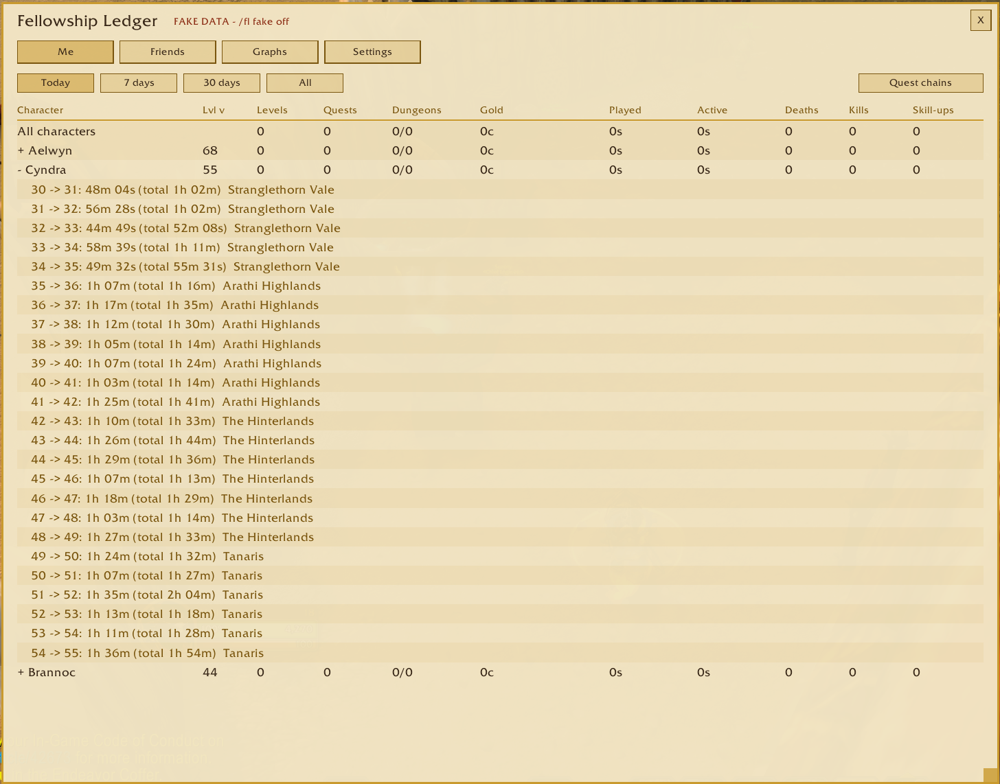
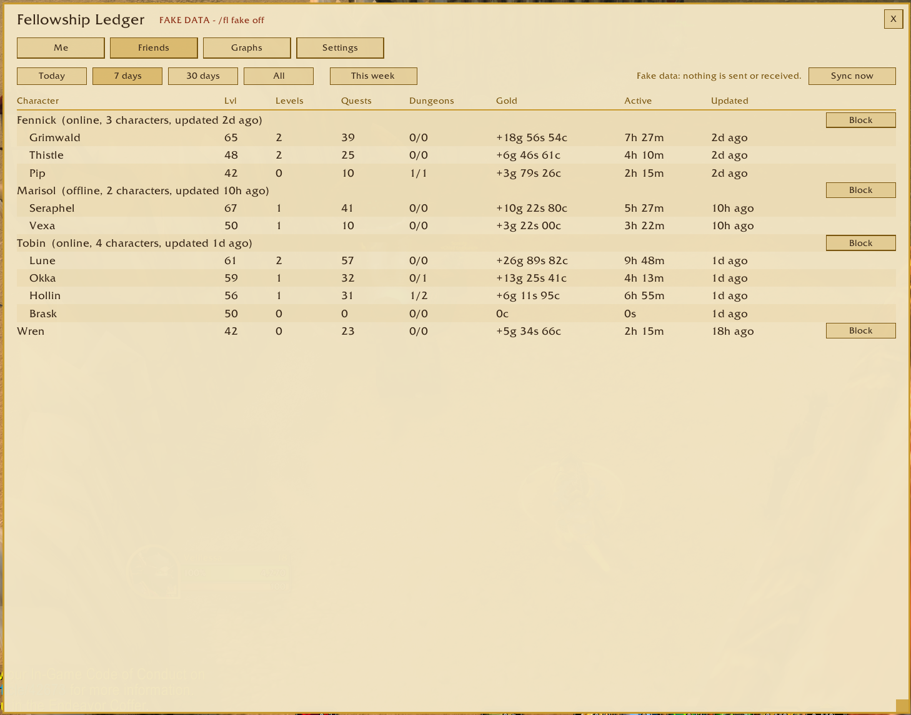
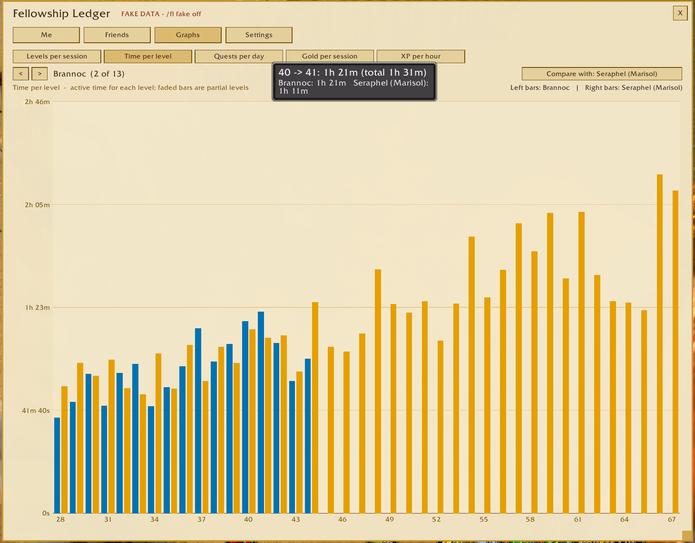
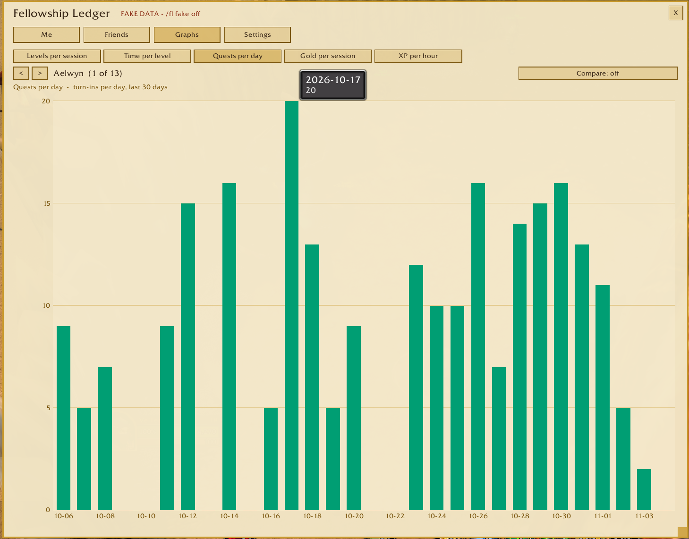
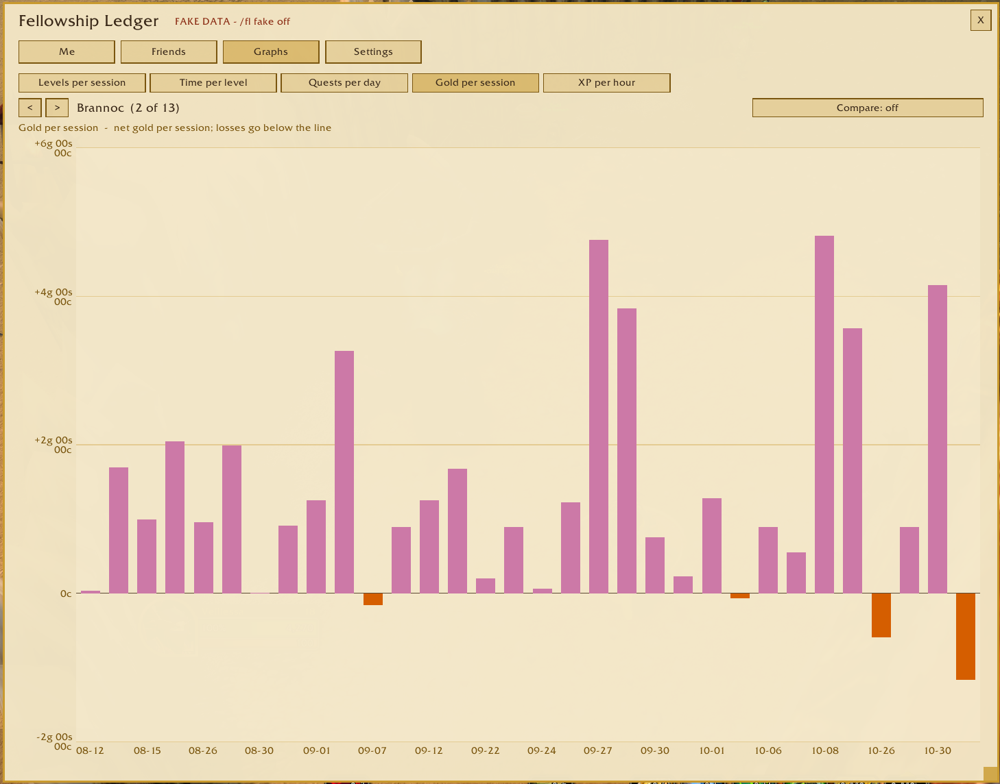
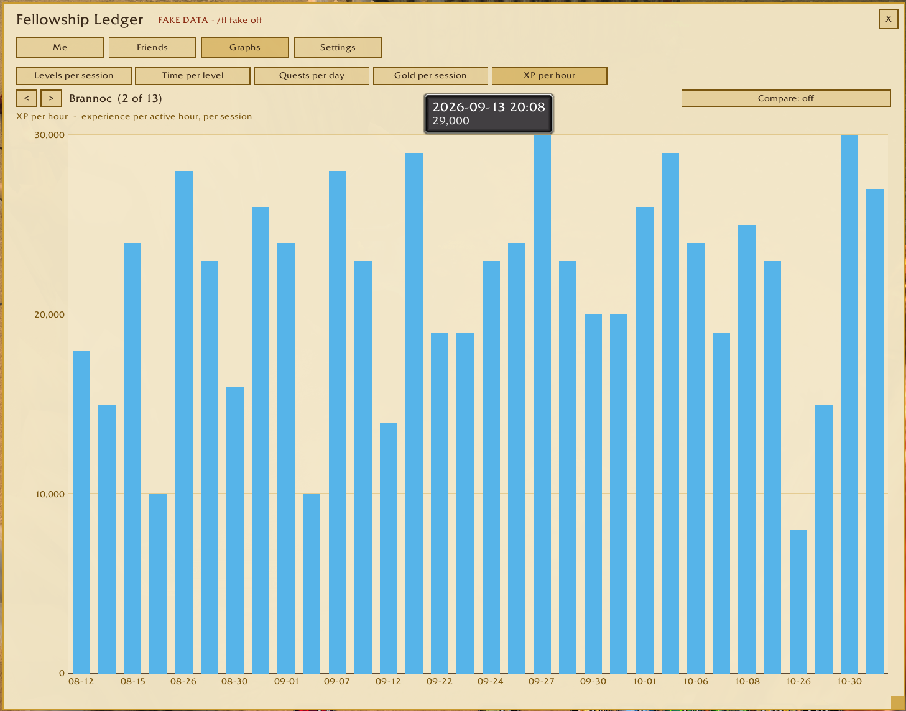
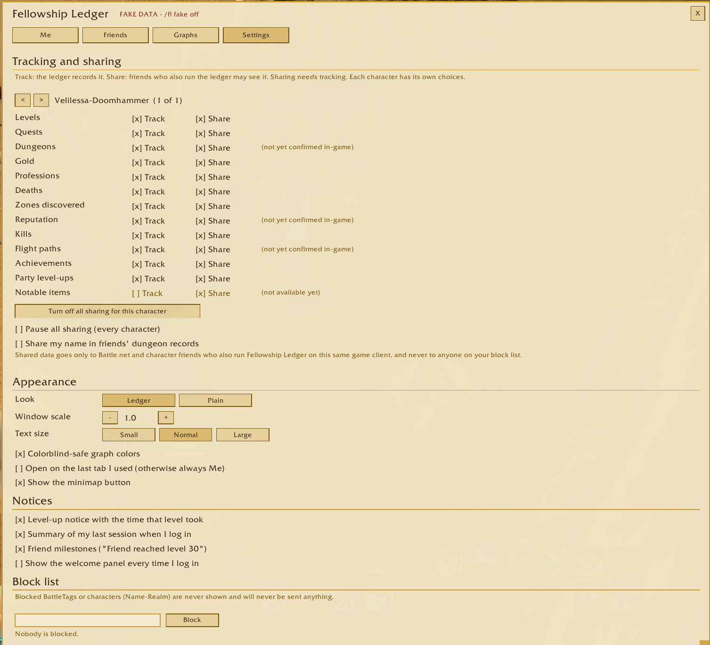

# Fellowship Ledger

*A ledger of your characters' adventures, shared with your fellowship.*

Fellowship Ledger quietly records what each of your characters does: levels and the time each one took, quests, dungeons, gold, professions and more. It shows them in a parchment-and-gold window with tables and graphs. Friends who also run the addon can share their ledgers with you, so you can see what each of you did today, this week or this month.

An addon for World of Warcraft. It supports **WoW Forever** and **retail**, and keeps their data completely separate.

> Status: **1.7.0**. WoW Forever is the main target and is tested in-game there, including sharing between Battle.net friends. Retail is supported too. See [CHANGELOG.md](CHANGELOG.md) for what each version added.

## What it tracks

| Tracker | What you see |
|---|---|
| Levels | Time per level as `1 -> 2: 10m 23s (total 14m 02s)`: active time (idle stretches over 5 minutes removed) and logged-in time; XP per hour; the zone where you levelled |
| Quests | Every turn-in (kept 30 days) and daily totals (kept 90 days); every quest the character has completed; quest chains: "step X of Y" from the game's data, or from Questie; quest details with objectives, start and end, levels and rewards |
| Dungeons | Every run: entered vs completed (final boss killed), clear time, when each boss died and how long the fight took, deaths, group make-up (class and role only) |
| Gold | Net per session, split into loot, vendor, quest, mail, auction and other, with a "Total gained" for any range |
| Professions | Skill-ups, time to each point, current rank |
| Extras | Deaths with what killed you and both levels, notable loot (green or better), zones discovered, reputation gained, kills (rare, elite, creature type), flight paths, achievements, party level-ups |

Every tracker has its own **Track** and **Share** switch for each character, and all are on by default.

## The window

Type **`/fl`**, or click the minimap button.

- **Me:** your characters for Today, 7 days, 30 days or All, with faction, class-colored names, "Last played" and a **This session** line at the top. Click a column to sort, and click a character for a summary card: average, fastest and slowest level, its recent levels, deaths (with your level and the killer's) and notable loot (hover an item for the game's tooltip), each with Show all, and a **Remove** button for characters you no longer play. Settings can show it as a list instead. Buttons along the top of the card switch to **Quests**, **Gold** (a large "Total gained", then in, out and net by source), **Kills**, **Professions**, **Quest chains** and **All completed**.
- **Quest chains:** one line per quest in your log, showing where you are in its chain. Click a chain for its quests, their levels and who starts each one, where, with map coordinates (from Questie). Click a quest for its details and rewards; hover a reward item for the game's own tooltip, as in your bags. A quest a friend also has shows "with Hamlet". Shift-click a quest or an item to link it in chat.
- **Friends:** friends who run the ledger, grouped under their Battle.net name, with "(playing)" on the character they are on, sortable by any column. Hover a character for details, or click it to open it like your own: their levels, totals, gold, kills, quest chains, profession ranks, dungeon runs with boss times, recent deaths and blue or better loot (whatever they share), and the quests in both your logs. **Right-click** a friend to whisper them or invite them to your group. **This week** and **Last week** give a summary, and **Sync now** shares right away. While you are both online, updates arrive about once a minute. If a friend runs a newer version, you get one reminder to update.
- **Graphs:** levels per session, time per level, quests per day, gold per session and XP per hour, with tooltips. Pick a character, and **Compare** with any other, yours or a friend's, from drop-downs grouped by friend.
- **Dungeons:** every run of your characters (when, clear time, bosses, deaths, who was with you by role, completed or not), opening to its bosses with when each died and how long the fight took; a summary per dungeon with your best and average time next to your **Friends' best**; and your friends' runs. A run counts once you are inside 5 minutes or a boss dies.
- **Settings:** tracking and sharing switches, the Ledger (parchment), Leather (dark) or Plain look, text size, scale, colorblind-safe colors (on by default), notices, the block list and recommended addons.

### Notices

Small notices, each with its own switch under Settings > Notices:

- **Yours:** level-ups, a session summary, and a **weekly recap** the first time you log in after the weekly reset (you and each friend: levels, quests, dungeons, time played).
- **Friends':** reaching level 10, 20, ... and the level cap, finishing a quest chain, clearing a dungeon, profession milestones, looting a blue or better item, and joining your ledger.
- Notices that arrive together become one, those from while you were offline become one "While you were away", and clicking a friend's notice opens their character on the right page. Hovering a friend's character in the world adds a "Ledger:" line to the game's tooltip.

### Screenshots

These use the made-up preview data from `/fl fake`.

| | |
|---|---|
|  |  |
| **Me:** your characters, with time per level | **Friends:** grouped under their Battle.net name |
|  |  |
| **Compare:** time per level next to a friend's character | **Quests per day** over the last 30 days |
|  |  |
| **Gold per session:** losses below the line | **XP per hour** per session |
|  | |
| **Settings:** Track and Share for each tracker, the look, notices and the block list | |

## Commands

| Command | What it does |
|---|---|
| `/fl` | Open or close the ledger |
| `/fl summary` | Your last session's summary (`/fl summary now` for this one) |
| `/fl export` | All your data as text you can copy and keep |
| `/fl sync` | Share with online friends now |
| `/fl fake` / `/fl fake off` | Preview every view with made-up data (never shared) |
| `/fl welcome` | Show the welcome panel |
| `/fl restore` | Restore this character from its backup |
| `/fl shots` | Screenshots of every tab with made-up data |
| `/fl version` | Version and client details |
| `/fl help` | Every command |
| `/fl verify`, `/fl test`, `/fl friends`, `/fl commtest`, `/fl comms`, `/fl probe`, `/fl debug` | Diagnostics |

## Privacy

- The ledger **never reads chat or the combat log**, and makes **no network connections**.
- Sharing goes only to your Battle.net and character friends who also run Fellowship Ledger on the same game client, and only for the trackers each character allows. One click pauses all sharing.
- Blocked players are never sent anything and never shown.
- Party members appear by name in your dungeon records only if they run the ledger and opted in.
- A backup of each character is kept in that character's own saved-variables file.

## Recommended

**Questie** adds fuller quest-chain information, especially on WoW Forever. Fellowship Ledger works without it.

## Development

The repo is laid out in [CLAUDE.md](CLAUDE.md), the design in [docs/ARCHITECTURE.md](docs/ARCHITECTURE.md) and the sync format in [docs/PROTOCOL.md](docs/PROTOCOL.md). Tests use LuaJIT: `luajit tests/run_all.lua`. Releasing is covered in [docs/RELEASING.md](docs/RELEASING.md).

## License

MIT, © Decoupled Lane Studio. See [LICENSE](LICENSE). Fellowship Ledger is not affiliated with or endorsed by Blizzard Entertainment.
